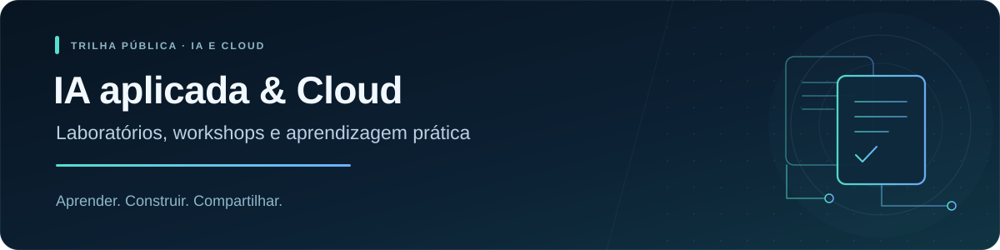
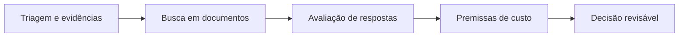

# IA aplicada e Cloud — do primeiro laboratório à decisão técnica

Uma trilha em português para construir projetos de IA aplicada à TI e entender como avaliar suas respostas, suas fontes e seus custos.

**Tiago Silveira Siqueira · Supervisão de TI · Infraestrutura, IA aplicada e cloud**

Cada etapa produz uma entrega que outra pessoa consegue revisar. A proposta conecta programação, operação, documentação e liderança técnica. Os projetos usam exemplos didáticos identificados, fatos públicos com fontes e execução local.

## Escolha o problema que você quer resolver

| Problema | Projeto | O que você pratica |
|---|---|---|
| Organizar uma triagem | [Azure + IA Operations Lab](https://github.com/TiagoSilveiraSiqueira/azure-ai-operations-lab) | Entradas estruturadas, evidências, hipóteses e limites de classificação |
| Encontrar informação em runbooks | [RAG Runbooks Lab](https://github.com/TiagoSilveiraSiqueira/rag-runbooks-lab) | Recuperação local, fragmentos citados e resposta sem base suficiente |
| Conferir respostas de IA | [AI Evaluation Lab](https://github.com/TiagoSilveiraSiqueira/ai-evaluation-lab) | Contratos de saída, casos de regressão e métricas determinísticas |
| Comparar custos de uma proposta | [Cloud FinOps Toolkit](https://github.com/TiagoSilveiraSiqueira/cloud-finops-toolkit) | Preços públicos, premissas de uso e cálculo reproduzível |
| Documentar uma rotina para o time | [Skills para times de TI](https://github.com/TiagoSilveiraSiqueira/skills-para-times-de-ti) | Runbooks, triagem e onboarding |
| Melhorar um pedido feito à IA | [Engenharia de prompts na prática](https://github.com/TiagoSilveiraSiqueira/engenharia-de-prompts-na-pratica) | Contexto, formato, rubricas e comparação de respostas |

## Seu primeiro laboratório

O percurso abaixo é uma sequência de aprendizagem. Os laboratórios são executados separadamente.

Comece com Python 3.10 ou superior e o modo `demo` do [laboratório de operações](https://github.com/TiagoSilveiraSiqueira/azure-ai-operations-lab). Siga seu início rápido, execute um cenário e confira a avaliação contra as evidências da entrada.

Entregue uma nota curta com três itens:

1. O fato observado e seu ID de evidência.
2. Uma hipótese que a entrada ainda não confirma.
3. A informação que ajudaria a escolher o próximo passo.

Essa primeira entrega permite revisar o raciocínio sem precisar de conta cloud ou de um modelo de linguagem. Quando você usar um modo de modelo local, registre se a saída realmente veio dele ou de um fallback.

## Uma trilha de quatro semanas

Este é um planejamento ajustável, não uma promessa de domínio. Reserve três sessões de 45–60 minutos por semana ou adapte a ordem ao seu tempo.

| Semana | Prática | Entrega revisável |
|---|---|---|
| 1 — Dados e triagem | Execute os cenários do Operations Lab e aplique a skill de triagem | Registro de fatos, hipóteses e lacunas |
| 2 — Documentos e fontes | Faça perguntas ao RAG Runbooks Lab e confira os fragmentos recuperados | Pergunta, fontes encontradas e limites da resposta |
| 3 — Avaliação | Execute o AI Evaluation Lab e analise um caso que falhou | Relatório com denominadores, falhas e critérios usados |
| 4 — Decisão | Compare um cenário FinOps e documente o procedimento | Estimativa com premissas, alternativas e runbook revisável |

Veja [TRILHA.md](TRILHA.md) para os exercícios e critérios de cada etapa e [WORKSHOPS.md](WORKSHOPS.md) para duas sessões em grupo.

## O que uma demonstração permite afirmar

| Evidência | Afirmação sustentada | Limite |
|---|---|---|
| Programa rodou com a entrada fornecida | Aquele fluxo foi executado naquele ambiente | Não comprova integração com produção |
| Testes passaram | As propriedades testadas passaram | Não comprova qualidade universal de um modelo |
| Resposta cita um fragmento recuperado | A referência existe no conjunto recuperado | Não comprova que toda frase esteja sustentada |
| Avaliador mediu fixtures | As métricas foram calculadas para aquelas respostas | Não representa um benchmark de LLMs reais |
| Catálogo registra preço público consultado | A estimativa usa aquele snapshot de preço | Não equivale à fatura de uma assinatura |

## Aprender com fontes públicas

Os projetos analisam os relatos oficiais da [Cloudflare sobre 2 de julho de 2019](https://blog.cloudflare.com/details-of-the-cloudflare-outage-on-july-2-2019/) e do [GitHub sobre 21 de outubro de 2018](https://github.blog/news-insights/company-news/oct21-post-incident-analysis/). Eles distinguem o conhecimento inicial da análise posterior.

O toolkit de custos usa preços públicos da Microsoft, identificando a origem e o momento da consulta no catálogo. Exemplos de utilização permanecem cenários de planejamento.

Fontes para aprofundar:

- [Python: tutorial oficial](https://docs.python.org/pt-br/3/tutorial/)
- [Microsoft: Azure Monitor](https://learn.microsoft.com/azure/azure-monitor/overview)
- [Microsoft: fundamentos de KQL](https://learn.microsoft.com/kusto/query/)
- [Microsoft: Azure Retail Prices API](https://learn.microsoft.com/rest/api/cost-management/retail-prices/azure-retail-prices)
- [GitHub Actions: documentação](https://docs.github.com/actions)
- [Ollama: documentação](https://docs.ollama.com/)

## Uma rotina de melhoria para quem lidera

Escolha uma tarefa recorrente, construa um exemplo pequeno e peça que outra pessoa tente reproduzi-lo. Registre onde ela encontrou dificuldade. Corrija a instrução ou o programa, adicione um caso de regressão quando ele verificar uma propriedade relevante e publique a mudança com sua evidência.

Para apresentar um resultado, explique o problema, a entrada, a decisão, o que foi observado e o que permanece incerto. Use [ENTREGA.md](ENTREGA.md) como roteiro de revisão.

Os laboratórios não precisam de dados de uma empresa. Mantenha credenciais, conversas profissionais e configurações internas fora das contribuições públicas.

## Contribuir

Uma dúvida reproduzível ajuda a melhorar a trilha. Informe a etapa, o cenário de laboratório, o resultado observado e o que você esperava conseguir verificar. Veja [CONTRIBUTING.md](CONTRIBUTING.md).

Conteúdo autoral sob [licença MIT](LICENSE). Fontes externas conservam seus próprios direitos e termos.

**English:** A practical learning path for applied AI, IT operations and cloud, with reproducible labs, source-aware retrieval, evaluation and cost assumptions.
